# Learning log

## 24-11-2026

Ik ben verder gaan werken an mijn website. Ik heb meer verpakkingen van filmrolletjes gemaakt en heb ze ook een soort 3d effect gegeven door borders toe te voegen. Ook zijn deze blokjes nu volledig responsive en passen ze aan aan de grootte van het beeld. Ik wil maken dat wanneer je op de verpakkingen klikt de pagina automatisch scrolt naar de correcte filmrol met foto's, dit moet ik nog doen.

Ik heb een custom font gebruikt met font face, deze had ik gehaald uit mijn research waar ik had gekeken naar meerdere fonts die zouden passen bij het idee. Ik heb gebruik gemaakt van StintUltaExpanded, dit heeft een soort old school look dat past bij de filmrolletjes.

Ook heb ik de achtergrond nu veranderd naar een gradient die steeds blauwer wordt naarmate je scrolt. Dit idee heb ik uit mijn visual research gehaald waar er gebruik gemaakt werd van veel blauwe kleuren en gradients. Ik vind het nu alleen nog niet echt mooi en zou graag iets anders willen doen met de achtergrond dus dit staat nog open voor verandering.

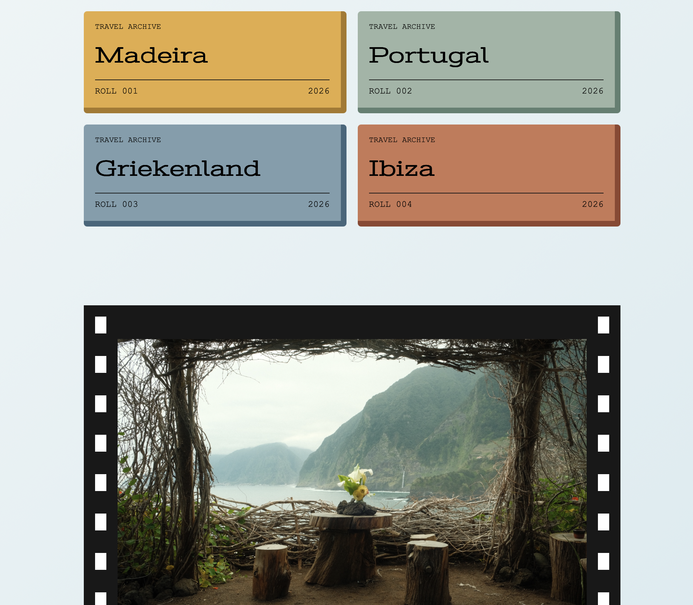

## 23-11-2026

Vandaag reden mijn bussen helaas niet vanwege staking. Ik ben dus thuis zelf begonnen.
Nu ik de filmrol al gemaakt heb heb ik het gevoel dat het nog te simpel is. Ik wil maken dat ik op een manier de filmrol kan wisselen per reis. Ik kwam dus op het idee om bovenaan de pagina een soort grid of vakjes te maken in de kleuren van filmrol verpakkingen met de namen van de landen erop. Als je er dan op 1 klikt scrollt de pagina vanzelf naarbeneden naar die rol van foto's. Ik heb een schets hiervan gemaakt:
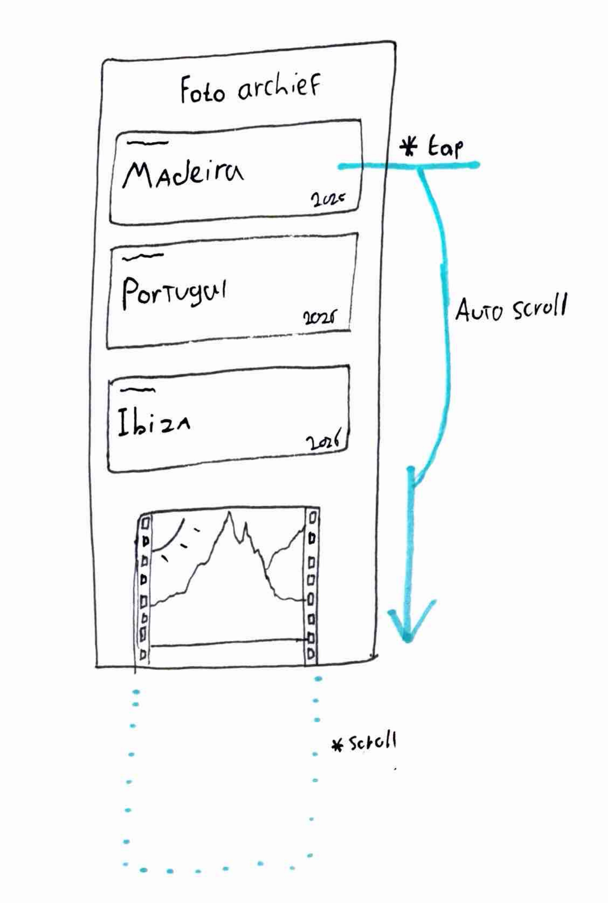

## 22-11-2026

### Grid practicum gedaan en geoefend.

Dit vond ik erg handig omdat ik denk dat ik zelf ook grids nodig ga hebben op mijn pagina.

### filmrol gemaakt in HTML met mijn eigen fotos en gestyled in css.

Ik heb de eerste versie van mijn filmrol gemaakt. Het moeilijkste hiervan was de css. Ik heb gebruik gemaakt van de gradients waar we mee geoefend hadden in het practicum. Ik wilde het helemaal zelf doen dus ik heb veel nog op moeten zoeken of moeten vragen aan AI, maar heb AI het niet laten schrijven. Uiteindelijk ben ik eruit gekomen en weet ik ook helemaal hoe het werkt.

## 20-11-2026

begonnen aan het maken van mijn html pagina. Ik heb ook feedback gehad op mijn schetsen van de docent. Ik had eerst het idee om een soort camera te maken waar dan filmrol uitkomt met mijn foto's erop. Dit heb ik na feedback toch geschrapt omdat het dan een 'apparaat in een apparaat' is. Ik kan dus beter echt gebruik maken van het scherm dat ik al heb.

### checkout, welk feedback heb je ontvangen?

batuhan:
De stijl bepalen van zijn onderwerp, kleuren, contrast etc.

## 18-11-2026

### presenteren aan Norwin en andersom

Tips van Norwin:

1. categorieen maken van de fotos.

Norwin:

1. Interactief leren door te spelen/simuleren
2. misschien meer visuele optische illusies
3. leerzaam, toegankelijk, eenvoudig
4. Simpel maken van concepten die op het eerste oog moeilijker lijken dan ze zijn.
5. Interactieve spellen / experimenten / videos.
6. Ik wil mijn Digital Garden laten gaan over optische illusies, kansberekeningen en de werking van menselijk brein.
   en wil dat laten zien door interactieve spellen en elementen aan content te tonen.
   Ik begin met een stukje eigen content over waarom het leuk en belangrijk is om over te leren . ​
   Als het begin is gemaakt kan ik mijn Garden verder uitbreiden door verschillende concepten aan elkaar te koppelen.

Een sfeerwoord dat past bij mijn onderwerp fotografie is denk ik avontuurlijk omdat ik vooral mijn fotos op reizen maak.

### 3 stappen visual research

Ik heb de 3 stappen van visual research uitgevoerd. Ik heb hieruit gehaald dat ik vooral organische vormen ga gebruiken, met blauw en groene kleuren. Het moet een abstracte manier zijn van natuur weergeven.

### Crazy 8

Ook heb ik vandaag een crazy 8 uitgevoerd waar ik in korte tijd 8 ideeen heb geschetst voor mijn garden. Hieruit heb ik gehaald dat ik eigenlijk iets wil doen met dat er een soort filmrol per reis uit de camera komt en deze vervolgens ontwikkelt wordt en dus de fotos zichtbaar worden.

### 5 schetsen

Ik heb 5 mobile first schetsen gemaakt van wat ideeen van de crazy 8, ik moet nog bepalen welke ik verder uit ga werken maar dit heeft me wel op goede ideeen gebracht:

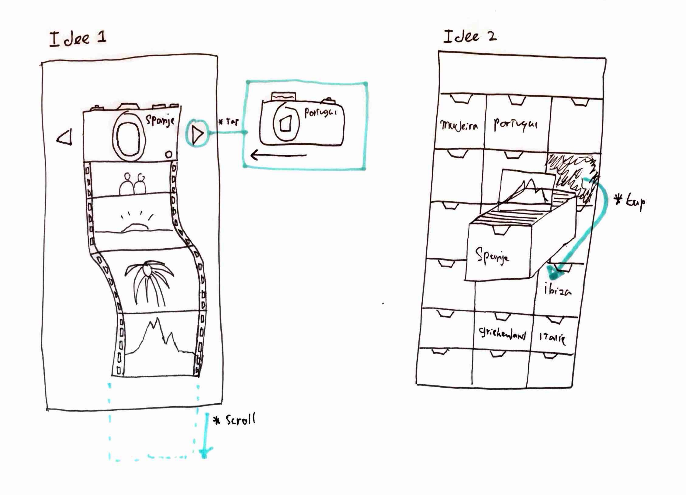
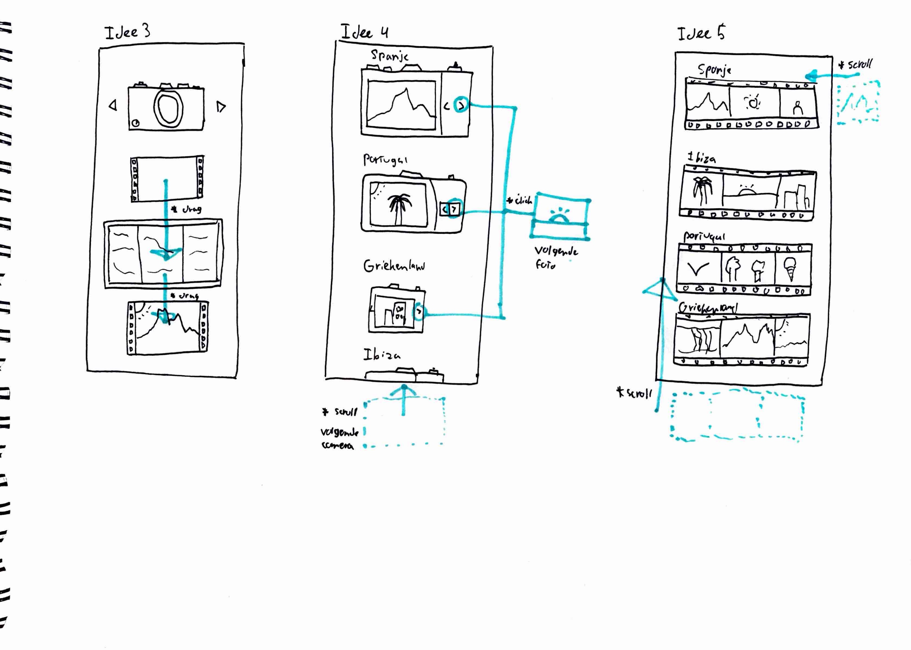

### kleurenpalet

Ik heb twee kleurenpalleten gemaakt, light en dark mode. Hiervoor heb ik gebruik gemaakt van de afbeeldingen van mijn visual research, vooral groen en blauw.
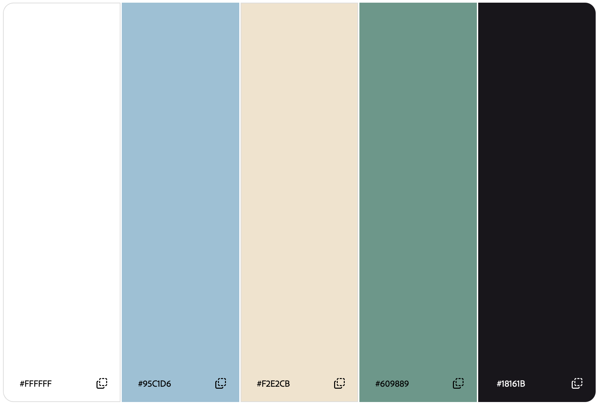
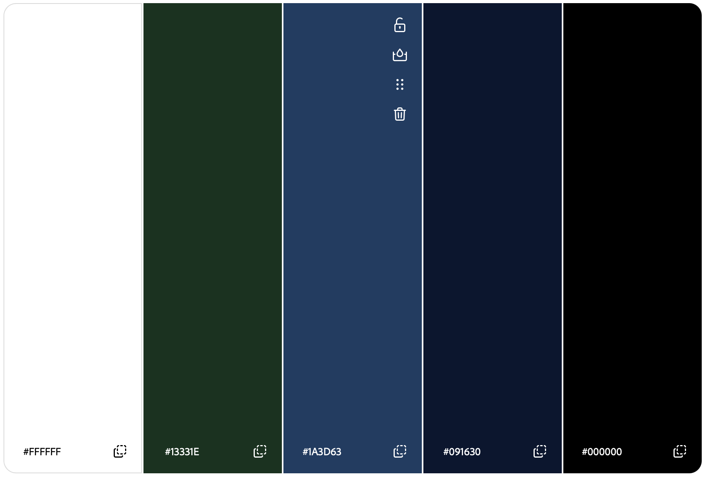

### font ideeën

Ik heb ook gekeken voor wat ideeën voor fonts dat ik kan gebruiken, omdat ik waarschijnlijk iets met filmrollen/polaroids wil doen in mijn ontwerp denk ik dat hier een wat 'old school' stijl fonts goed bij passen. Ik heb dus een selectie gemaakt van een aantal die mij aanspraken. Ik wil dus niet simpel modern sans serif waarschijnlijk.

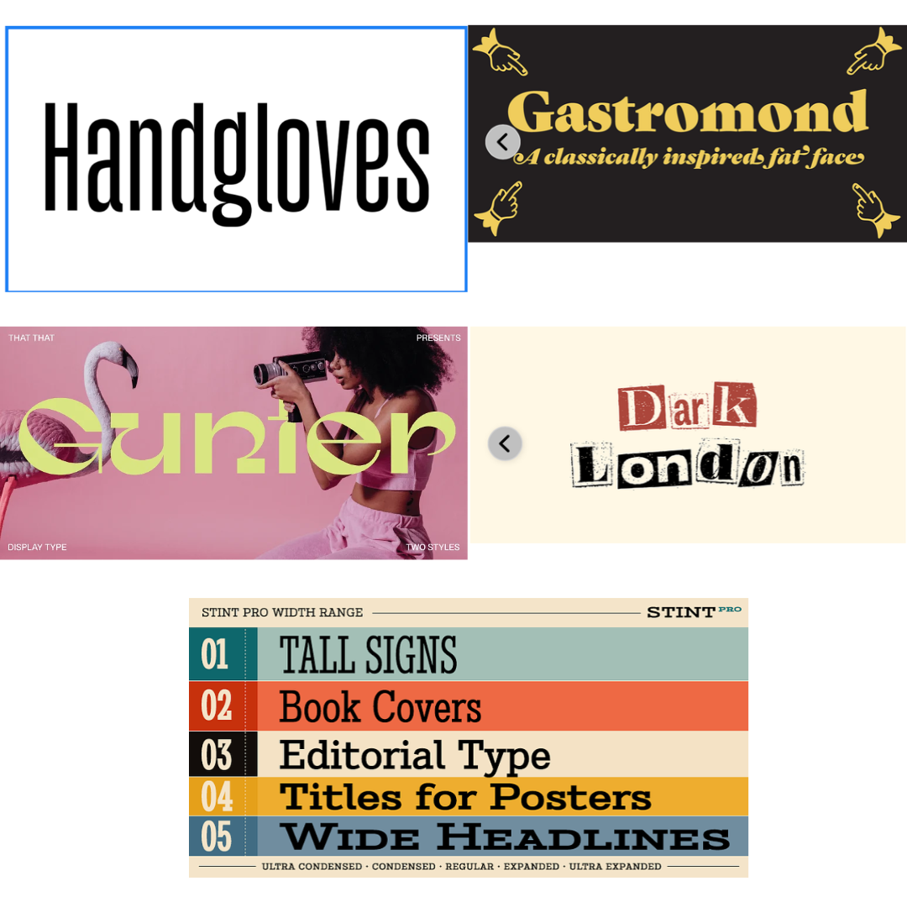

### gradients en colors practica

Als laatste heb ik het practica gedaan over gradients en colors. Ik heb hier veel geleerd.

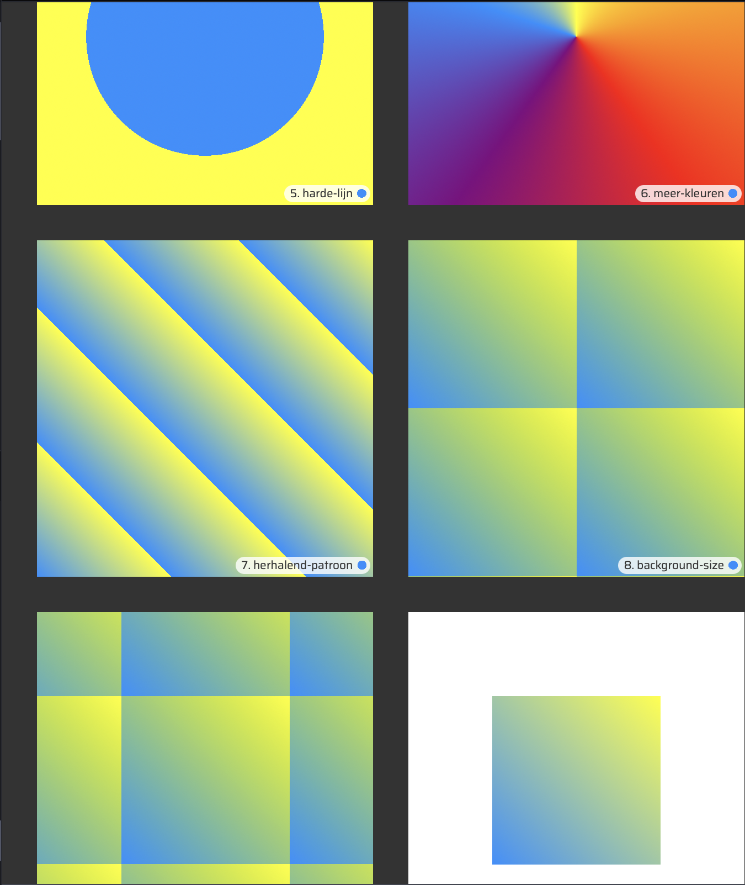
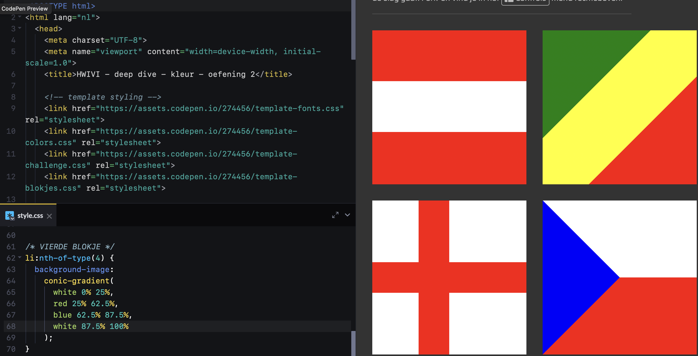

### checkout

1. Het gevoel dat je ontwerp kan brengen en wat voor visuele elementen daar bij horen.
2. Kans berekeningen en optische illusies. Doormiddel van interactieve spellen/elementen
3. Het dobbeelsteen idee waar het getal waar het op land het je brengt naar dat experiment en het verbonden web idee.

## 17-11-2026

Vandaag heb ik mijn html presentatie gemaakt over fotografie.

Ook heb ik de oefening over light en dark mode thuis gedaan. Hier heb ik geleerd hoe ik pagina's kan aanpassen aan de light of dark mode instelling van het systeem of met knoppen op de pagina. Ook heb ik geleerd hoe je de afbeeldingen kan aanpassen op basis van het beeldschermgrootte.
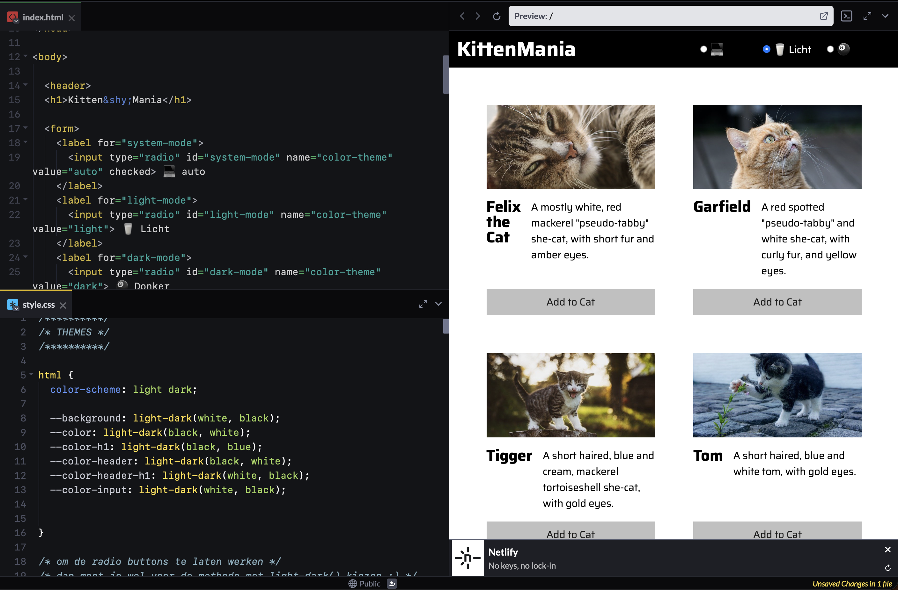
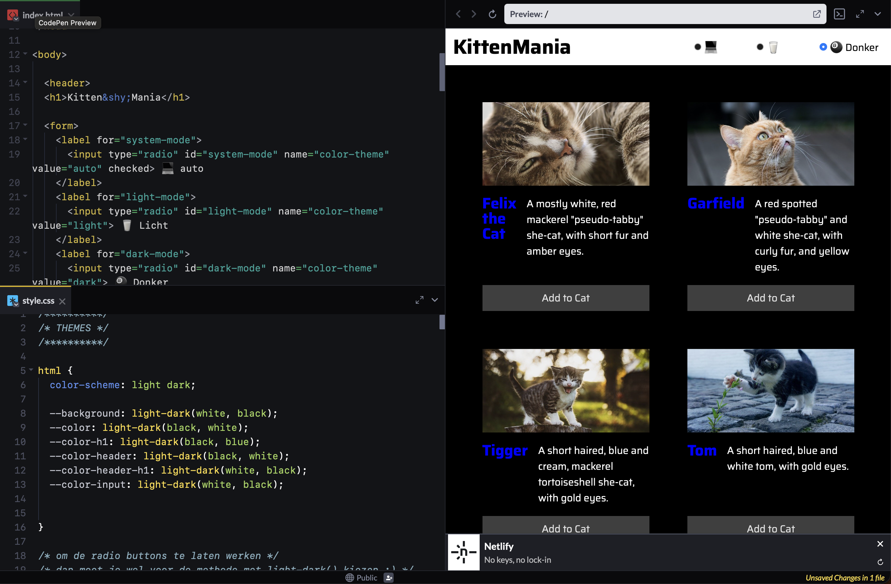

### responsive images

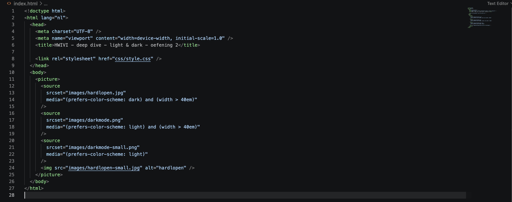

## 16-11-2026

### Onderzoek webby-ness van andere digitial gardens

Ik en Norwin hebben samen gekeken naar digital gardens van anderen. Hier hebben we er 2 van uitgekozen: churchbasement.org en mikemai.net. Vervolgens hebben op een formulier ingevuld welke we wel en niet webby vonden.

Daarna hebben wij samen met Luke en Batuhan ook gekeken naar hun websites en zij naar die van ons en vergeleken welke van die het meest en misnt webby is. Hier hebben we uitgehaald welke elementen wel en niet er voor zorgen dat het webby is. We merkten vooral dat het lag aan de toegankelijkheid.

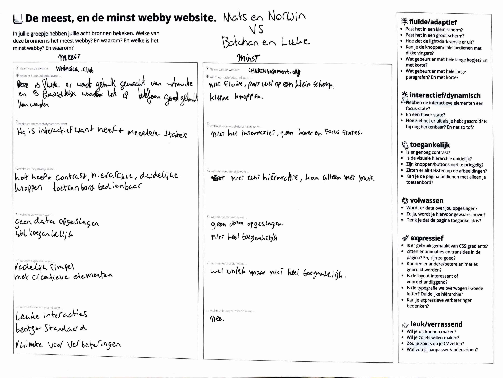

### Mijn digital garden eerste idee

Ik zou graag voor mijn garden iets willen doen met fotografie. Ik wil dit graag interactief maken en met animaties. Bijvoorbeeld een camera die je kan gebruiken waar mijn foto's uit komen. Ik had bij een website gezien dat je een soort geanimeerde gradient kan maken, dit lijkt mij best cool.

Voor de content kan ik gebruik maken van foto's die ik zelf heb gemaakt op allemaal verschillende reizen die ik heb gedaan. Ik kan dus ook vertellen over waarom ik de foto heb genomen en waarom ik hem leuk vindt. Het is vooral informerend en als een soort inspiratie voor anderen.

Vooral eigen content denk ik maar misschien fotografen die mij inspireren. Ik denk als ik vertel wat hun werk voor mij betekent en waarom dat invloed heeft op mijn foto's dat dat wel als mijn eigen beschouwd kan worden. Ik moet wel altijd hun bronnen vermelden.

Vooral via beeld kan het ervaren worden. Maar misschien kan nog iets van muziek op de achtergrond toevoegen. Bijvoorbeeld een nummer uit het specifieke land waar ik geweest ben. Ook doe ik af en toe videografie wat ik eventueel nog zou kunnen toevoegen.

### Checkout met Hale

1. Digital gardens zijn vaak een persoonlijke verzameling van allemaal interesses en experimenten. En een reguliere webstie zijn vaak formeel en van een bedrijf met een doel.
2. Animaties, interactie, toegankelijkheid, vormgeving, typografie, goed schaalbaar.
3. Hale wilt een website maken waar ze de atomic habits van een boek gaat uitleggen en hoe dat past bij haar.

## 13-11-2026

Vandaag was de les van nicky uitgevallen dus heb ik zelf de opdracht van de Wok To Walk gemaakt. We moesten bedenken hoe we het menu digitaal konden maken. Ik heb dit gedaan in figma. Ik heb gebruik gemaakt van ronde selectievakjes wanneer je maar 1 optie mag kiezen, en vierkante selectie vakjes wanneer je er meerdere mag kiezen.

Vervolgens hebben we een les gehad waar we leerden beter schetsen. We hebben eerst wat oefeningen gedaan waar we verschillende lijnen moesten trekken en vormen moesten tekenen. Daarna had ik een app uitgekozen om na te gaan schetsen met de nieuwe technieken. Ik heb hier geleerd hoe de balans tussen kwaliteit en snelheid eruit ziet en hoe je interacties/animaties kan schetsen. Ik heb Instagram geschetst.

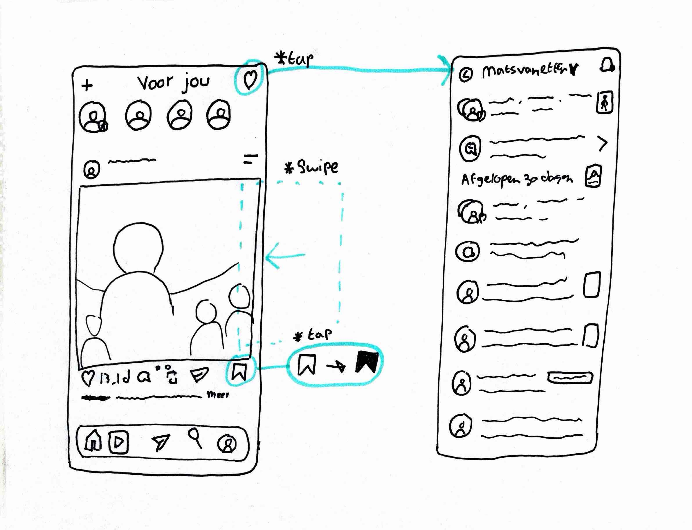

## 11-11-2026

Vandaag heb ik gemaakt en geleerd hoe ik met CSS mijn html pagina mooier en functioneler kan maken. Ik heb geleerd over variabelen, buttons met hovers, labels en forms.

Ook heb ik in de tweede les veel geleerd over fonts en hoe je ze kan manipuleren en hoe je eigen fonts kan toevoegen.
Ik heb voor opdracht 1 twee voorbeelden na moeten maken:

Daarna heb ik gekozen om nog 1 simpele na te maken en 1 gemiddelde moeilijkheidsgraad:

## 10-11-2026

Voorbereidings opdracht Practische CSS en fonts met kleur en effecten gedaan.

## 9-11-2026

Als je een aapssing doet in je code dan kan je deze via source control committen naar je website.

Ik heb gezoen om mijn naam matsvanetten als domeinnaam te gebruiken, deze hebben we gekoppeld door DNS adressen aan te pasen zodat het verbonden is met github. Ik wacht alleen nu nog op de DNS check.

Een source hosting platform is een pagina waarop je jou website bestanden kan uploaden en ook live op het web zetten, wij hebben gekozen voor github omdat het gratis is en je makkelijk kan kopellen aan VSC.
