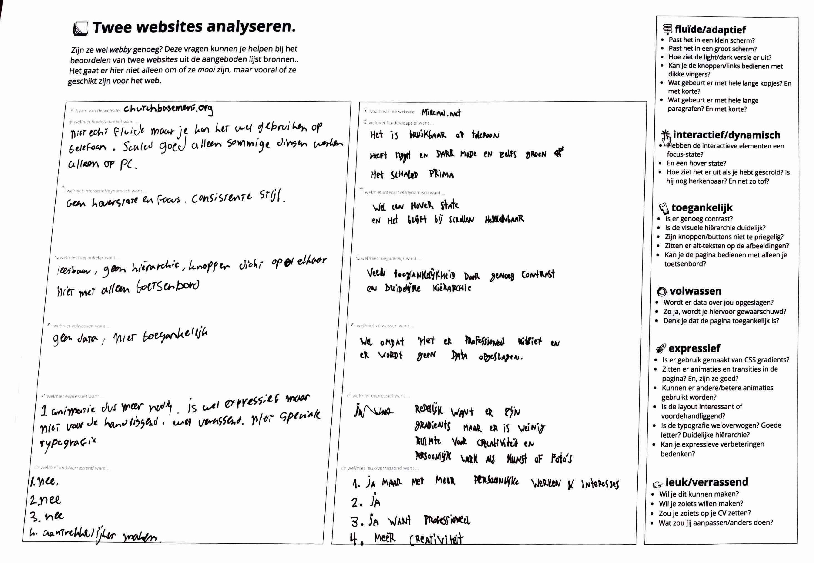
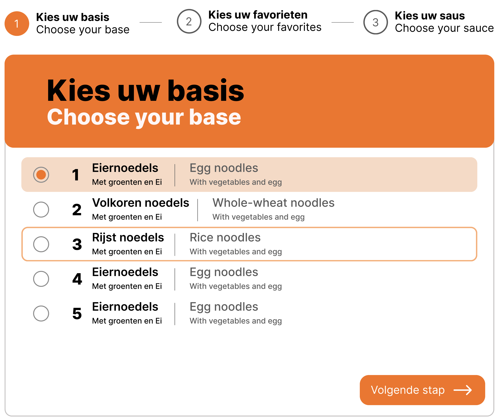
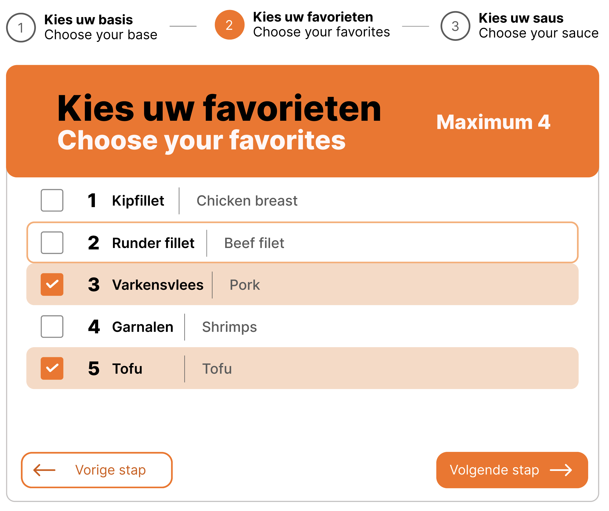
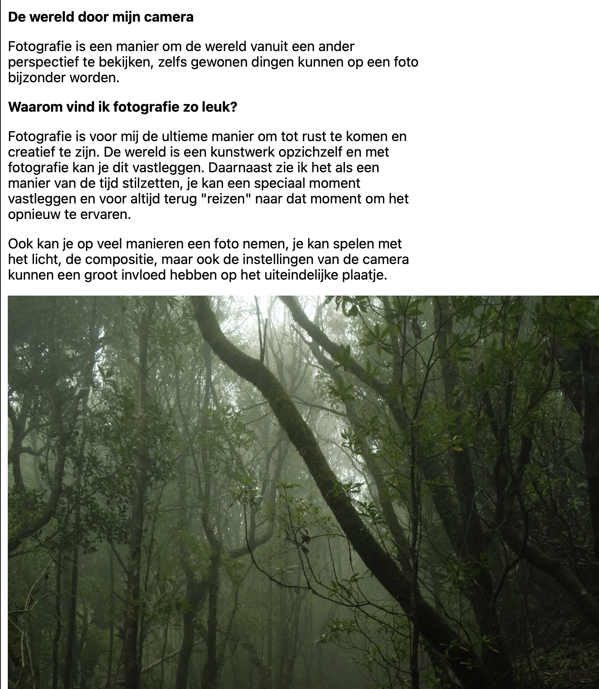
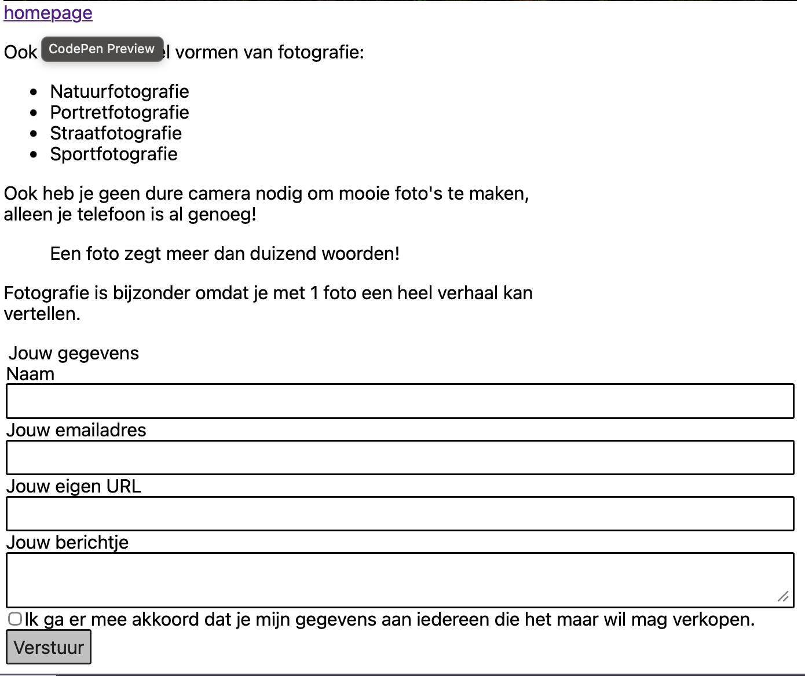
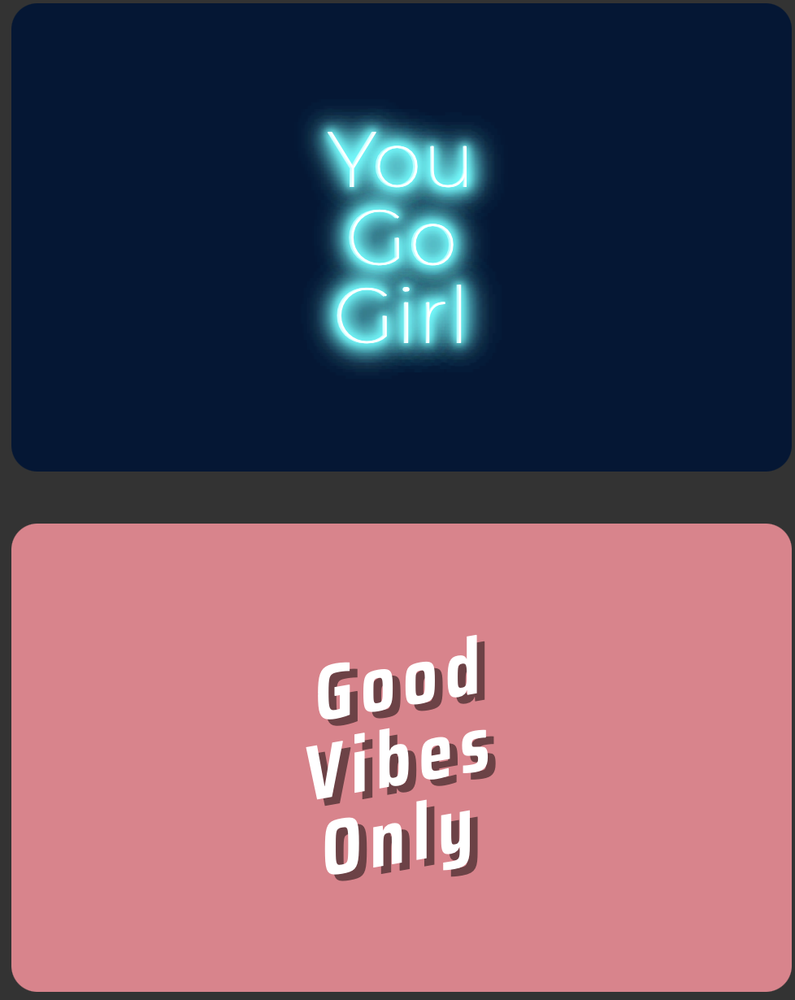
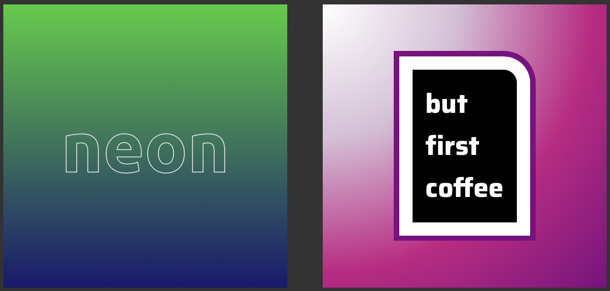

# Learning log

## 16-11-2026

### Onderzoek webby-ness van andere digitial gardens

Ik en Norwin hebben samen gekeken naar digital gardens van anderen. Hier hebben we er 2 van uitgekozen: churchbasement.org en mikemai.net. Vervolgens hebben op een formulier ingevuld welke we wel en niet webby vonden.

Daarna hebben wij samen met Luke en Batuhan ook gekeken naar hun websites en zij naar die van ons en vergeleken welke van die het meest en misnt webby is. Hier hebben we uitgehaald welke elementen wel en niet er voor zorgen dat het webby is. We merkten vooral dat het lag aan de toegankelijkheid.

### Mijn digital garden eerste idee

Ik zou graag voor mijn garden iets willen doen met fotografie. Ik wil dit graag interactief maken en met animaties. Bijvoorbeeld een camera die je kan gebruiken waar mijn foto's uit komen. Ik had bij een website gezien dat je een soort geanimeerde gradient kan maken, dit lijkt mij best cool.

Voor de content kan ik gebruik maken van foto's die ik zelf heb gemaakt op allemaal verschillende reizen die ik heb gedaan. Ik kan dus ook vertellen over waarom ik de foto heb genomen en waarom ik hem leuk vindt. Het is vooral informerend en als een soort inspiratie voor anderen.

Vooral eigen content denk ik maar misschien fotografen die mij inspireren. Ik denk als ik vertel wat hun werk voor mij betekent en waarom dat invloed heeft op mijn foto's dat dat wel als mijn eigen beschouwd kan worden. Ik moet wel altijd hun bronnen vermelden.

Vooral via beeld kan het ervaren worden. Maar misschien kan nog iets van muziek op de achtergrond toevoegen. Bijvoorbeeld een nummer uit het specifieke land waar ik geweest ben. Ook doe ik af en toe videografie wat ik eventueel nog zou kunnen toevoegen.

### Checkout met Hale

1. Digital gardens zijn vaak een persoonlijke verzameling van allemaal interesses en experimenten. En een reguliere webstie zijn vaak formeel en van een bedrijf met een doel.
2. Animaties, interactie, toegankelijkheid, vormgeving, typografie, goed schaalbaar.
3. Hale wilt een website maken waar ze de atomic habits van een boek gaat uitleggen en hoe dat past bij haar.

## 13-11-2026

Vandaag was de les van nicky uitgevallen dus heb ik zelf de opdracht van de Wok To Walk gemaakt. We moesten bedenken hoe we het menu digitaal konden maken. Ik heb dit gedaan in figma. Ik heb gebruik gemaakt van ronde selectievakjes wanneer je maar 1 optie mag kiezen, en vierkante selectie vakjes wanneer je er meerdere mag kiezen.

Vervolgens hebben we een les gehad waar we leerden beter schetsen. We hebben eerst wat oefeningen gedaan waar we verschillende lijnen moesten trekken en vormen moesten tekenen. Daarna had ik een app uitgekozen om na te gaan schetsen met de nieuwe technieken. Ik heb hier geleerd hoe de balans tussen kwaliteit en snelheid eruit ziet en hoe je interacties/animaties kan schetsen. Ik heb Instagram geschetst.

## 11-11-2026

Vandaag heb ik gemaakt en geleerd hoe ik met CSS mijn html pagina mooier en functioneler kan maken. Ik heb geleerd over variabelen, buttons met hovers, labels en forms.

Ook heb ik in de tweede les veel geleerd over fonts en hoe je ze kan manipuleren en hoe je eigen fonts kan toevoegen.
Ik heb voor opdracht 1 twee voorbeelden na moeten maken:

Daarna heb ik gekozen om nog 1 simpele na te maken en 1 gemiddelde moeilijkheidsgraad:

## 10-11-2026

Voorbereidings opdracht Practische CSS en fonts met kleur en effecten gedaan.

## 9-11-2026

Als je een aapssing doet in je code dan kan je deze via source control committen naar je website.

Ik heb gezoen om mijn naam matsvanetten als domeinnaam te gebruiken, deze hebben we gekoppeld door DNS adressen aan te pasen zodat het verbonden is met github. Ik wacht alleen nu nog op de DNS check.

Een source hosting platform is een pagina waarop je jou website bestanden kan uploaden en ook live op het web zetten, wij hebben gekozen voor github omdat het gratis is en je makkelijk kan kopellen aan VSC.
